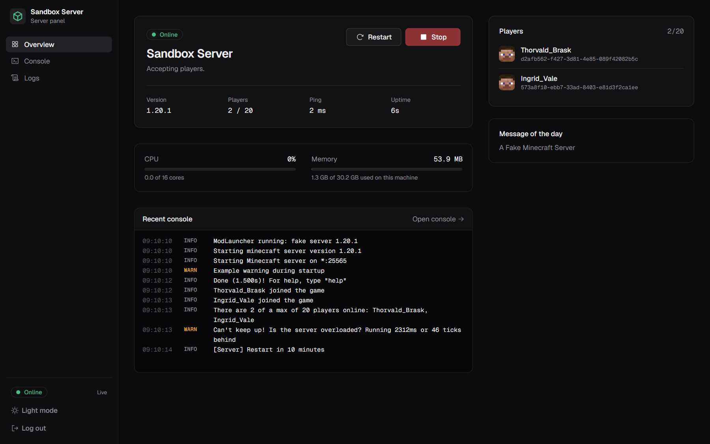
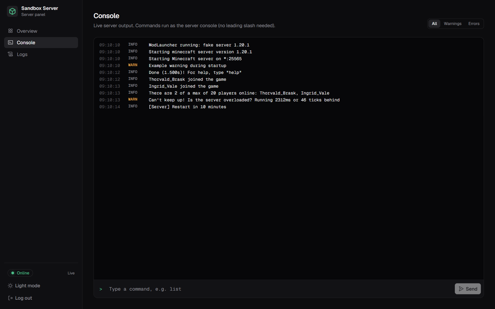

# mc-server-panel

A small self-hosted web panel for one Minecraft Java server: see its status, start and stop it, follow and use
the console, browse the logs and see who is online. Built for vanilla, Paper, Fabric, Forge and NeoForge servers
on Linux (it understands both the vanilla and the Forge log format).



## Features

- **Status** — online/starting/stopping/offline/crashed, uptime, version, MOTD, ping, CPU and memory of the
  server process.
- **Start, stop, restart** — through systemd (with a narrow sudo rule) or by running the server in tmux directly.
- **Live console** — streamed over a WebSocket, level filters, stack traces kept together, command history.
- **Logs** — the live `latest.log` and archived `*.log.gz` files, search, level filter, download.
- **Players** — who is online, from the server's own status ping (no plugin or RCON needed).
- **Login** — one password (scrypt-hashed), signed session cookie, rate-limited login attempts.
- Dark and light theme, works on phones.



## How it talks to the server

| What                 | How                                                                            |
| -------------------- | ------------------------------------------------------------------------------ |
| Console input        | `tmux send-keys` into the session that runs the server                         |
| Console output, logs | tails `logs/latest.log`, reads archived logs from the same folder              |
| Players, version     | Server List Ping on the game port (the same request the multiplayer menu uses) |
| CPU, memory          | `/proc` of the process running in the tmux session                             |
| Start / stop         | `systemctl --no-block start/stop/restart <unit>` or tmux directly              |

The server must therefore run inside a **tmux session**, and the panel must run as the **same user** as the server.
No server mods, plugins or RCON are required.

## Requirements

- Linux with Node.js 22 or newer and tmux
- systemd if you use `control.type = "systemd"` (recommended)

## Install

1. **Build** (anywhere with Node.js): `npm ci && npm run build`. Everything the panel needs is in `dist/`
   (`server.js` plus the web UI in `dist/public/`); no `node_modules` are needed on the server.
2. **Copy** `dist/` to the server, e.g. `/opt/mc-panel/`.
3. **Configure**: copy [`deploy/config.systemd.example.json`](deploy/config.systemd.example.json) (or the
   [tmux-only variant](deploy/config.tmux.example.json)) to `/etc/mc-panel/config.json` and adjust it.
4. **Set the password** (as the server user): `MC_PANEL_CONFIG=/etc/mc-panel/config.json node /opt/mc-panel/server.js set-password`.
   This adds the password hash and a session secret to the config (file mode 0600).
5. **systemd only**: run the server as a unit inside tmux (see
   [`deploy/minecraft.service.example`](deploy/minecraft.service.example)) and allow the panel user to control
   exactly that unit with [`deploy/sudoers.example`](deploy/sudoers.example) (`visudo -f /etc/sudoers.d/mc-panel`).
6. **Run the panel** with [`deploy/mc-panel.service`](deploy/mc-panel.service):
   `systemctl enable --now mc-panel`, then open `http://<server>:8080`.

## Configuration

`config.json` (path from `--config`, `$MC_PANEL_CONFIG` or `./config.json`):

| Key                                 | Default           | Meaning                                                      |
| ----------------------------------- | ----------------- | ------------------------------------------------------------ |
| `listen.host` / `listen.port`       | `0.0.0.0:8080`    | Where the panel listens                                      |
| `server.name`                       | `Minecraft`       | Name shown in the panel                                      |
| `server.directory`                  | —                 | Server working directory                                     |
| `server.logDirectory`               | `logs`            | Log folder, relative to `directory`                          |
| `server.logFile`                    | `latest.log`      | The file the server is writing                               |
| `server.tmuxSession`                | `minecraft`       | tmux session running the server                              |
| `server.tmuxSocket`                 | default socket    | Optional `tmux -S` socket path                               |
| `server.address`                    | `127.0.0.1:25565` | Game address for the status ping                             |
| `server.control.type`               | —                 | `systemd` or `tmux`                                          |
| `server.control.unit`               | —                 | systemd: unit name                                           |
| `server.control.sudo`               | `true`            | systemd: call `systemctl` via `sudo -n`                      |
| `server.control.startCommand`       | —                 | tmux: command started in the session                         |
| `server.control.stopCommand`        | `stop`            | tmux: console command for a graceful stop                    |
| `server.control.stopTimeoutSeconds` | `120`             | tmux: kill the session if the server has not stopped by then |
| `auth.passwordHash`                 | —                 | Written by `set-password`                                    |
| `auth.sessionSecret`                | —                 | Written by `set-password`; changing it logs everyone out     |
| `auth.sessionDays`                  | `30`              | Session lifetime                                             |
| `auth.secureCookie`                 | `false`           | Set to `true` when served over HTTPS                         |

## Security notes

- Anyone logged in can run any console command (`op`, `stop`, …). Use a strong password.
- The panel speaks plain HTTP. Keep it on your LAN/VPN, or put it behind a reverse proxy with HTTPS and set
  `auth.secureCookie`.
- Login attempts are limited to 5 failures per 5 minutes per client. Logins, actions and console commands are
  logged to the panel's stdout (journald).
- The sudo rule only allows `start`, `stop` and `restart` of one unit.

## Development

```sh
npm ci
npm run sandbox      # builds, then runs panel + fake Minecraft server in Docker on :8080
npm run dev          # Vite dev server with hot reload, proxies /api to the sandbox
```

Sandbox password: `sandbox-password`. The fake server (`tools/fake-server/fake-server.mjs`) logs like Forge,
answers the status ping and understands `list`, `say`, `stop` plus test commands such as `fake:join <name>`,
`fake:warn <msg>` and `fake:error <msg>`.

| Command             | What it does                                                        |
| ------------------- | ------------------------------------------------------------------- |
| `npm run lint`      | ESLint + Prettier check                                             |
| `npm run typecheck` | TypeScript for web and server                                       |
| `npm test`          | Unit tests (Vitest)                                                 |
| `npm run build`     | Production build into `dist/`                                       |
| `npm run test:e2e`  | Playwright tests against a fresh Docker sandbox (run `build` first) |

CI runs all of the above on every push and pull request.

### Layout

```
server/src/   backend (Fastify): config, auth, control adapters, log tailing, status ping, process stats
web/src/      frontend (React, Tailwind CSS, shadcn/ui)
shared/       types and the log-line parser used by both
tools/        fake Minecraft server for development and tests
docker/       sandbox image and compose file
e2e/          Playwright end-to-end tests
deploy/       example systemd units, sudoers rule and configs
```

## License

MIT
